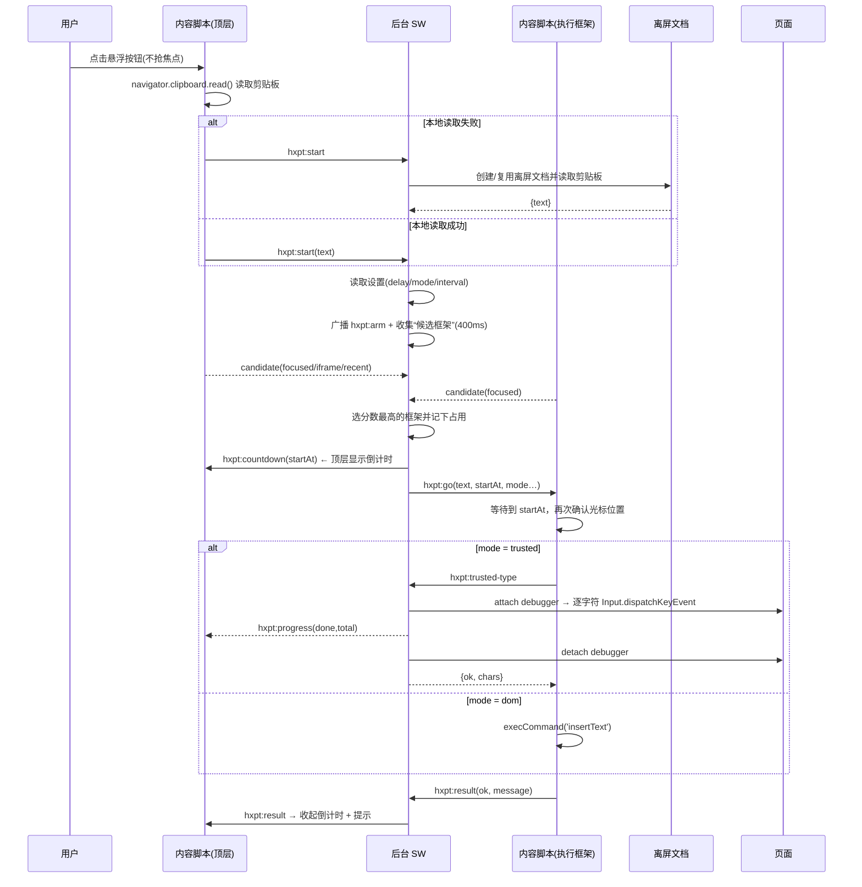

# 架构说明

## 一、组件

```
┌──────────────────────────────────────────────────────────────────────┐
│ 浏览器进程                                                           │
│                                                                      │
│  ┌──────────────────┐   chrome.runtime.sendMessage    ┌──────────┐  │
│  │ 内容脚本(每帧)    │ ──────────────────────────────▶ │ 后台 SW  │  │
│  │ content.js       │ ◀────────────────────────────── │ background│  │
│  │ - 悬浮按钮/UI     │      chrome.tabs.sendMessage     └────┬─────┘  │
│  │ - 倒计时          │                                      │        │
│  │ - DOM 输入        │                                      │        │
│  └──────────────────┘                                      │        │
│           ▲                                                │        │
│           │ chrome.storage.sync                            ▼        │
│  ┌────────┴─────────┐                       ┌────────────────────┐ │
│  │ popup / options  │                       │ offscreen.html      │ │
│  │ 弹窗 / 设置页     │                       │ (reason: CLIPBOARD)│ │
│  └──────────────────┘                       │ 读取剪贴板          │ │
│                                             └────────────────────┘ │
│                                                                      │
│  chrome.debugger + CDP Input.dispatchKeyEvent → 可信键盘事件 → 页面   │
└──────────────────────────────────────────────────────────────────────┘
```

| 文件 | 角色 |
| --- | --- |
| `content.js` | 每个匹配的框架都会注入；负责 UI、倒计时、DOM 输入、焦点记录 |
| `background.js` | 协调者：读剪贴板、挑选执行框架、驱动 CDP 输入、处理快捷键 |
| `offscreen.js` | 没有 UI 的离屏文档，借它只做一件事：读剪贴板 |
| `popup.*` | 工具栏弹窗：状态、快捷设置、一键触发 |
| `options.*` | 设置页：等待时间、输入方式、权限管理 |
| `shared/config.js` | 默认设置、设置读写、剪贴板文本提取等纯函数 |

## 二、一次“悬浮按钮触发”的完整流程



## 三、几个关键设计

### 1. 候选框架选择（多 iframe 支持）

超星页面里输入框可能在 iframe 中。触发时后台广播 `hxpt:arm`，每个框架返回自己掌握的信息：

| 候选类型 | 分数 | 含义 |
| --- | --- | --- |
| `focused` | 3 | 当前 `document.activeElement` 是可编辑元素（最理想） |
| `iframe` | 2 | 焦点在本框架内嵌的 iframe 里（跨域编辑器、本框架无法直接操作） |
| `recent` | 1 | 本框架最近编辑过输入框（用户刚点了弹窗/按钮的场景） |

取最高分、同分先到先得；`iframe` 候选会强制使用“真实键盘模拟”（CDP 键盘事件发往“焦点所在的 frame”，与发起框架无关）。

### 2. 输入引擎

- **trusted**：`chrome.debugger.attach` → `Input.dispatchKeyEvent`。
  - 每个字符派发 `type: 'char'`（`isTrusted = true`，与真人按键产生的默认文本插入一致）；
  - 换行派发 `rawKeyDown(Enter) + char('\r') + keyUp`；
  - `\t` 替换为 4 个空格；
  - 输入结束立刻 `detach`。
- **dom**：`document.execCommand('insertText')` 优先；失败时对 `input/textarea` 用原型 `value` setter 写值并派发 `input` 事件（绕过 React 等框架的 value 追踪），对 `contenteditable` 用 `Range.insertNode` 插入文本节点。

### 3. 为什么点悬浮按钮不会丢焦点？

悬浮按钮的 `mousedown` 事件里 `preventDefault()`，浏览器就不会把焦点从输入框切到按钮上；光标位置得以保留。按钮的“点击”逻辑绑定在 `pointerup` 上，并区分“拖动”和“点击”（位移 < 5px 视为点击）。

### 4. 占用与清理

- `claims`：`tabId → {frameId, expiresAt}`，防止同一标签页并发触发；
- 收到 `hxpt:result` / `hxpt:abort` / 标签页关闭 / 标签页开始导航时立即清理；
- `typingSessions`：CDP 输入会话，允许用户按 Esc 时中断循环。

### 5. 焦点守护

CDP 输入期间每 250ms 检查 `document.activeElement`：如果焦点变成“既不是可编辑元素、也不是 iframe”的普通元素（例如搜索框、链接），主动发 `hxpt:abort` 中断，避免把内容打到错误位置。

## 四、消息一览

| 消息 | 方向 | 说明 |
| --- | --- | --- |
| `hxpt:ping` | 后台 → 内容 | 探活（判断内容脚本是否就绪） |
| `hxpt:arm` | 后台 → 内容(广播) | 寻找可用框架 |
| `hxpt:candidate` | 内容 → 后台 | 上报候选 |
| `hxpt:countdown` | 后台 → 顶层内容 | 顶层显示倒计时 |
| `hxpt:go` | 后台 → 执行框架 | 开始倒计时与输入 |
| `hxpt:progress` | 后台 → 顶层内容 | CDP 输入进度 |
| `hxpt:result` | 执行框架 → 后台 → 顶层 | 结果与提示（后台负责转发） |
| `hxpt:abort` | 顶层/执行框架 → 后台 → 执行框架 | 中止 |
| `hxpt:aborted` | 后台 → 顶层内容 | 收起倒计时 |
| `hxpt:start` | 内容/弹窗 → 后台 | 统一触发入口 |
| `hxpt:capabilities` | 内容 → 后台 | 查询是否已授权 debugger |
| `hxpt:trusted-type` | 执行框架 → 后台 | 请求 CDP 逐字符输入 |
| `hxpt:peek` | 弹窗 → 后台 | 读取剪贴板用于预览 |
| `hxpt-offscreen / read` | 后台 → 离屏文档 | 读取剪贴板 |
